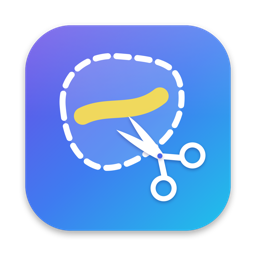
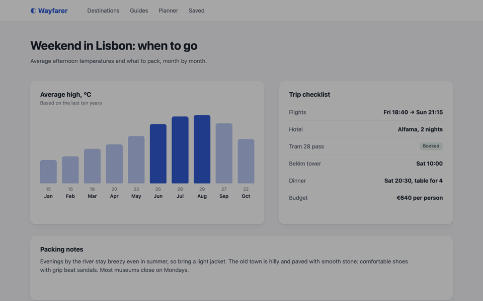
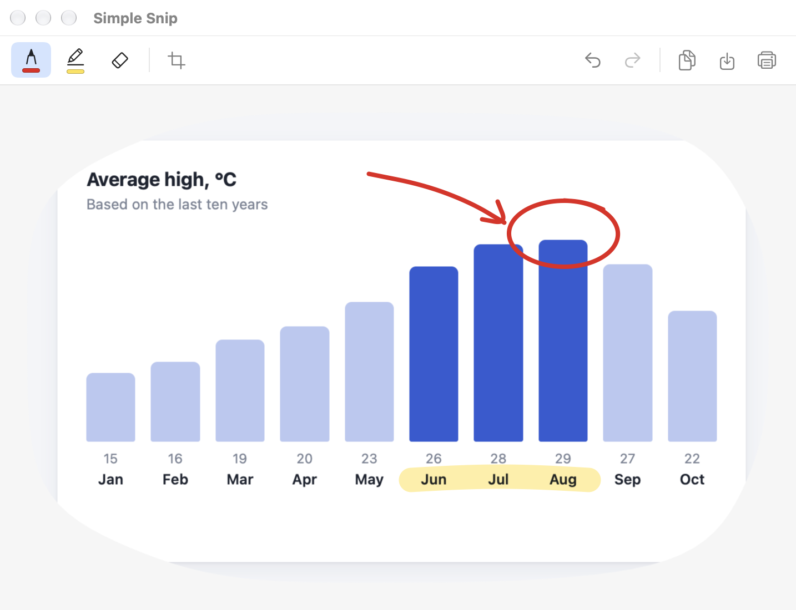

  

<h1 align="center">Simple Snip</h1>

  <b>Draw around anything on your screen to snip it, then mark it up.</b> 
  A free, open-source screen snipping tool for macOS, with freeform and rectangle snips and a pen and highlighter editor.

  <a href="https://github.com/Pavloff207/simple-snip/releases/latest/download/SimpleSnip.zip"><b>⬇ Download for Mac</b></a>
  &nbsp;·&nbsp;
  <a href="https://pavloff207.github.io/simple-snip/">Website</a>
  &nbsp;·&nbsp;
  <a href="CHANGELOG.md">What's new</a>

  

## Coming from Windows?

Simple Snip works the way you're used to. Press a shortcut, the screen freezes, and you drag a rectangle around what you want, or, in freeform mode, draw any shape. The snip goes straight to your clipboard and opens in a small window where you can draw on it, highlight it, crop it, save it or print it.

macOS's built-in screenshot tool only takes rectangles and windows. Simple Snip adds the **freeform snip** and a **quick markup editor** that opens right away.

## Features

- **Rectangle or freeform snips.** Drag a rectangle, or switch to freeform in Settings and draw any outline.
- **Every display.** The screen freezes while you snip, so menus and tooltips stay put.
- **Straight to the clipboard,** ready to paste into chat, email or a document.
- **Mark it up:**
  - a pen and a highlighter, each with a color palette and adjustable size
  - an eraser
  - crop
  - undo and redo
- **Save or print** as PNG or JPEG. Optionally, it asks before you close an edited snip without saving it.
- **Your own shortcut** (default ⌘⇧2), plus a menu bar icon and a Dock icon.
- **Launch at login,** so it's always ready.
- **Private by design.** No accounts, no analytics, no network access. Your screenshots never leave your Mac.

  

## Install

1. [Download **SimpleSnip.zip**](https://github.com/Pavloff207/simple-snip/releases/latest/download/SimpleSnip.zip) and open it.
2. Drag **Simple Snip** into your **Applications** folder.
3. Open it. The first time, macOS warns that it can't verify the app, because Simple Snip isn't notarized by Apple yet (it's coming). To open it anyway:
   1. Click **Done** in the warning.
   2. Open **System Settings → Privacy & Security**, scroll down, and click **Open Anyway** next to Simple Snip.
   3. Confirm with your password.
4. Press **⌘⇧2** to take your first snip. macOS asks for **Screen & System Audio Recording** permission, which Simple Snip needs to see the screen. Turn it on, then reopen Simple Snip.

You only do steps 3 and 4 once. Simple Snip needs macOS 26 (Tahoe) or later, on Apple silicon or Intel.

## FAQ

**Why does it need screen recording permission?**
To take the screenshot. macOS asks that permission of every screenshot app. Simple Snip has no network access, so nothing it captures can leave your Mac.

**How do I change the shortcut or the snip shape?**
Click the scissors icon in the menu bar, then **Settings…**.

**Where do my snips go?**
To the clipboard, and into the editor window. They're saved to a file only when you click **Save**.

**How do I uninstall it?**
Quit it from the menu bar icon and drag it from Applications to the Trash.

## Build from source

1. Install Xcode 26 or later.
2. Open `SimpleSnip.xcodeproj`.
3. Under Signing & Capabilities, choose your own team.
4. Run.

The project has no third-party dependencies.

Use a real signing identity, even a free Apple Development one. macOS ties the screen recording permission to the app's signature, so with ad-hoc signing it asks for permission again after every build.

The images in this README come from `Tools/demo/make_demo.sh`, which renders them with the app's own code.

## Contributing

Bug reports, ideas and pull requests are welcome. See [CONTRIBUTING.md](CONTRIBUTING.md).

## License

[MIT](LICENSE) © 2026 Andrey Pavlov
