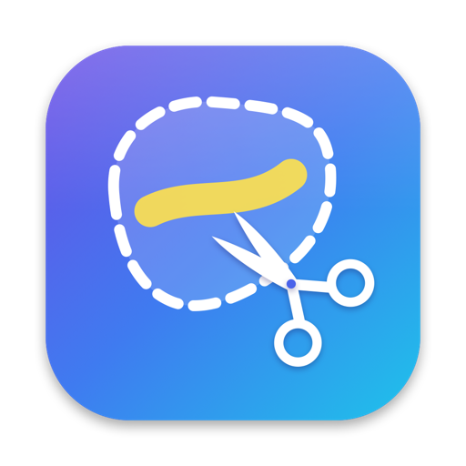

  

<h1 align="center">Simple Snip</h1>

Freeform and rectangle screen snips for macOS, with a quick pen and highlighter editor.

---

If you're coming from Windows, this workflow will feel familiar. Press a shortcut, then draw around anything on screen (any shape, not only rectangles). The snip goes straight to your clipboard and opens in a small editor for marking up.

## Features

- **Freeform or rectangle snips.** Draw any outline, or drag a rectangle. Pick the shape in Settings.
- **Works across all your displays.** The screen freezes while you snip, so menus and tooltips stay put.
- **Straight to the clipboard,** ready to paste into chat, email or a document.
- **Mark it up:**
  - pen and highlighter, with color palettes and adjustable size
  - eraser
  - crop
  - undo and redo
- **Save as PNG or JPEG.** Optionally, Simple Snip asks before you close an edited snip without saving it.
- **Your own global shortcut** (default ⌘⇧2), plus a menu bar icon and a Dock icon.
- **Launch at login.**
- **Private.** Nothing leaves your Mac: no accounts, no analytics, no network access.

## Requirements

macOS 26 or later.

## Install

Signed and notarized downloads are coming soon. Until then, build it yourself (see below).

The first time you snip, macOS asks for **Screen & System Audio Recording** permission. Simple Snip needs it to see the screen. You can change it later in System Settings → Privacy & Security.

## Build from source

1. Install Xcode 26 or later.
2. Open `SimpleSnip.xcodeproj`.
3. Under Signing & Capabilities, choose your own team.
4. Run.

The project has no third-party dependencies.

Use a real signing identity, even a free Apple Development one. macOS ties the screen recording permission to the app's signature, so with ad-hoc signing it asks for permission again after every build.

## License

[MIT](LICENSE) © 2026 Andrey Pavlov
